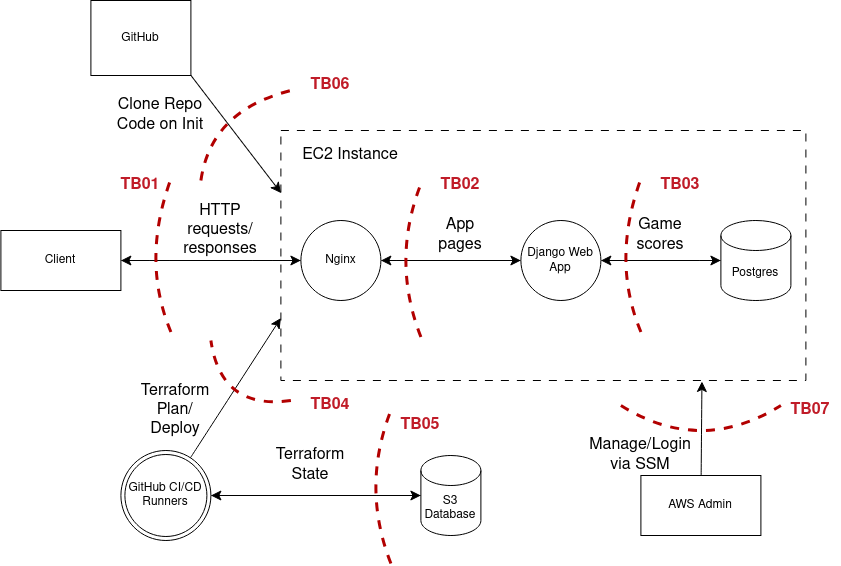

# Terraform Pipeline

## Overview

The purpose of this project is to develop a secure deployment pipeline that will detect any insecure changes to application code and block deployment if security gaps are found. The pipeline enforces checks against known vulnerabilities in terraform configuration, package dependencies, container vulnerabilities and static code analysis. Future work includes dynamic testing using OWASP ZAP or other scanning tools against the live application.

## Threat Model

The data flow diaram highlights 7 trust boundaries that need to be analysed. The STRIDE threat analysis process will be used to evaluate these threats.
## STRIDE Analysis
### TB01: Client to Nginx
| Id | Threat | Target | Description |
|----|--------|--------|-------------|
|1| Spoofing | Client | Attacker in MITM position can spoof site and produce a self-signed cert if TLS is not in place. |
|2| Spoofing | Nginx | TLS Spoofing: TLS is not setup or is using self-signed certificates. There is no way for Nginx to know it is communicating securely with the client without a certificate signed by a CA. An attacker can intercept packages, relay them to Nginx.|
|3| Tampering | Nginx | Attacker gains access to Nginx config and configures it to expose system information (ex. adding debug headers). |
|4| Tampering | Nginx | HTTP request smuggling via ambiguous Content-Length/Transfer-Encoding. |
|5| Repudiation | Nginx | Requests are unauthenticated. No account creation exists to limit user data collection (and subsequent risk of exfiltration). Users can submit fraudulent scores tied to no account and with no audit trail.
|6| Information Disclosure | Client | If attacker is able to gain access to clients Cookies via for example a reflected XSS attack, they can read their session state and spoof their requests. |
|7| Information Disclosure | Nginx | Attacker can learn Nginx version number or oher information from application stack based on HTTP response and response headers|
|8| Denial of Service | Client | Client could suffer a DNS cache poisoning attack, preventing resolution of server address or redirecting the client to a spoofed site |
|9| Denial of Service | Nginx | Request Flood attack overwhelms Nginx and valid client requests are dropped |

### TB02: Client/Nginx to Django Web App
| Id | Threat | Target | Description |
|----|--------|--------|-------------|
|10| Spoofing | Django | Attacker gains access to docker and sends spoofed request from Nginx container to open port 8000 on docker network |
|11| Tampering |  Django | Attacker sends reflected XSS payload in the name field during the score POST HTTP Request. Django stores that record in the database and reflects the XSS payload to other users. |
|12| Repudiation | Django | Attacker can claim non-repudiation because no app-level logging exists for state changes. If app-level logging exists, an attacker can find and delete the log file since it exists on the same server as the application. |
|13| Information Disclosure | Django | Existance of /admin path hints at the application being a Django app. /admin page adds more attack surface and more privelege to exploit. |
|14| Information Disclosure | Django | Crash reports disclose information about the application to the user if they are enabled. |
|15| Information Disclosure | Django | Error messages can disclose information on incorrect form submission on score submission form. |
|16| Denial of Service | Django | Django Monolith setup can be prone to resource exhausion under heavy load. Nginx, Django, and PSQL all running on same EC2 Instance and fighting for resources. |
|17| Denial of Service | Django | Django served by Gunicorn has static number of workers. Slow clients can tie up workers and restrict service to other clients. |
|18| Elevation of Privilidge | Django | Regular user can access admin-only actions because the admin check is not performed correctly. |

### TB03: Django Web App to Postgres
| Id | Threat | Target | Description |
|----|--------|--------|-------------|
|19| Spoofing | Postgres | Attacker connects to database from a compromised docker container by guessing credentials or using reused or default credentials. |
|20| Tampering | Postgres | Attacker injects SQL into name field in POST Score endpoint. SQL is run as is against database. |
|21| Repudiation | Postgres | Database changes are not logged, allowing for non-repudiation. If logging file exists on same instance as postgres, attacker can delete the logs if they gain acces to the system.|
|22| Information Disclosure | Postgres | Attacker who gains access to database via compromised EC2 instance can exfiltrate all data contained in database. |
|23| Denial of Service | Postgres | Attacker can inject large payloads in POST Score, impacting database performance if they end up in the database. |
|24| Denial of Service | Postgres | Connection pool exhaustion can occur if Django doesn't limit max connections or if too many requests are incoming. |
|25| Elevation of Privilidge | Django | Attacker compromises Django and connects to the Database over the Docker network using superuser permissions |

### TB04: GitHub CI/CD Runners to EC2 Instance

| Id | Threat | Target | Description |
|----|--------|--------|-------------|
|26| Spoofing | EC2 | Attacker spoofs session token using a man in the middle attack. Attacker logs in to AWS using token and creates an EC2 instance by assuming the GitHub IAM Role. Attacker uses EC2 Instance for Crypto mining. |
|27| Spoofing | GitHub | If IAM Role trust policy is too permissive, attacker can obtain a legitimately issued access token. The trust sub policy follows repo:org/repo:* meaning that any branch or fork of the specified repo could be given a legitimate access token and execute actions on EC2 via IAM role they are given access to.|
|28| Tampering | CI/CD Runners | Compromised upstream dependency attack: Attacker adds malicious code in a third party GitHub action used by runners. This code is pulled and run by runners on push. Payload can be used to exfiltrate secrets or abuse AWS IAM role permissions |
|29| Tampering | CI/CD Runners | Malicious project contributer can edit the pipeline.yml file causing checks to be missed or allow pushing insecure code to EC2. |
|30| Repudiation | EC2 | Branch protection is not turned on. A malicious contributer could force push to main and overwrite git history. |
|31| Information Disclosure | CI/CD Runners | When project is set to public, CI/CD Runners may leak information such as secrets or other sensitive information in terraform plan or other build artifacts.|
|32| Information Disclosure | CI/CD Runners | Third party GitHub actions are given access to code and secrets. If they are compromised, data exfiltration can occur. Flagging them with sensitive=true will hide them from outputs.
|33| Denial of Service | CI/CD Runners | A flood of runner requests (many prs opened at once) could exhaust the runners and prevent a valid deploy.|
|34| Denial of Service | CI/CD Runners | Any attacker that is able to cause a gate to fail either via changing the requirements upstream if it is a third party gate or by editing the app code to fail the gate will be able to prevent a deploy |
|35| Elevation of Privilidge | EC2 | Attacker compromises terraform plan GitHub action and is given readonly access to IAM and EC2. Apply action has write access to EC2. If the apply action applies the plan generated in the plan section, attacker can perform write actions by modifying the plan it generates.

### TB05: CI/CD Runners to S3 Database
| Id | Threat | Target | Description |
|----|--------|--------|-------------|
|36| Tampering | S3 | If an attacker can write to S3 either by a compromised apply runner or write permissions to the terraform config can write a poisoned terrform state. A poisoned state will affect future deployments of the application|
|37| Repudiation | S3 | S3 records are not logged. Attacker can modify S3 data without leaving audit trail |
|38| Information Disclosure / Elevation of Privilidge | S3 | Terraform state is stored in S3 in Plaintext. Attacker who gains access to S3 database can view the terraform state. They may be able to obtain secrets from the terraform state allowing them to access other parts of the system such as the GitHub Repo or the EC2 Instance | 
|39| Denial of Service | S3 | Attacker who gains write permissions to Dynamodb by compromising either the plan or apply runner and their respective IAM roles can hold the mutex lock and prevent any other process from obtaining the mutex and reading or writing the terraform state. This will prevent deployments and tests. |

### TB06: GitHub to EC2 - REMOVED (Replaced With Pre-Built Containers in Pipeline and ECR Store)

| Id | Threat | Target | Description |
|----|--------|--------|-------------|
|40| Spoofing | EC2 | Network level attacker intercepts first connection to GitHub via a compromised DNS. Attacker presents a fake key and feeds malicious payload to ec2 to execute. |
|41| Tampering | GitHub | Contributer intentially or unintentionally commits malicious code to repo, repo gets pulled in and malicious code is run. |
|42| Tampering | GitHub | Attacker exploits the time window between code scanning checks and deployment by pushing malicious code to the repo after checks pass and before EC2 spins up and checks out code from repo. |
|43| Repudiation | GitHub | GitHub does not log use of SSH key, and attacker can use compromised key to exfiltrate application code without audit trail |
|44| Information Disclosure | GitHub | Attacker who gains access to SSH Token will be able to read all files in repo. They will not be able to write as it is a readonly key. |
|45| Denial of Service | GitHub | Third party dependency. If an attacker is able to cause GitHub to go down, app will not be able to checkout code and deploy. |
|46| Elevation of Privilidge | GitHub | Anyone able to merge code into the repo is able to have code execute as a root in a docker container on the EC2 Instance via docker compose. |

### TB07: AWS Admin to EC2 or AWS Console
| Id | Threat | Target | Description |
|----|--------|--------|-------------|
|47| Spoofing | AWS Console | Attacker connects to console or via ssm using stolen credentials |
|48| Tampering | AWS Console | Attacker connects to console via admin account credentials and spins up unauthorized resources |
|49| Repudiation | AWS Console | CloudTrail logs admin actions by default, but no alerting/review process exists to actually catch unauthorized changes when they occur. |
|50| Repudiation | AWS Console | Compromised Admin account could delete its own cloudtrail logs, protecting it from repudiation. |
|51| Information Disclosure | AWS Console | A compromised admin account can view/edit EC2 instances, view/edit IAM roles, and view budget. |
|52| Denial of Service | AWS Admin | Compromised AWS admin can remove accounts, change passwords, and destroy services |

## Threat Ranking
Each of the threats are ranked based on risk. In this case, risk = (impact if threat does occur) x (likelyhood of threat occuring). The top risks are the most likely to occur withh the highest impact if they do occur. Impact is not based on quanitative values such as money in this case, but represents the qualitative impact on the application and its overall status. Likelyhood represents the likelihood a incident will occur given how easy the threat is to exploit. A Threat will be either be mitigated, accepted, avoided, or transferred to the client or another entity. Threats not yet addressed are marked as open.

| Impact ↓ / Likelihood → | Low | Medium | High |
|---|---|---|---|
| **High**   |  |  |      | Extreme |
| **Medium** |     |    |     |
| **Low**    |     |       |   |

|Id|Threat|Target|Description|Impact|Likelihood|Risk&nbsp;&nbsp;&nbsp;|Mitigation|Status|
|--|------|------|------------|------|---------|----|-----------|-----------|
|2| Spoofing | Nginx | TLS Spoofing: TLS is not setup or is using self-signed certificates. There is no way for Nginx to know it is communicating securely with the client without a certificate signed by a CA. An attacker can intercept packages, relay them to Nginx.|  |  |  | Use a TLS Cert from a trusted CA and attach domain name | Open |
|11| Tampering |  Django | Attacker sends reflected XSS payload in the name field during the score POST HTTP Request. Django stores that record in the database and reflects the XSS payload to other users. |  |  |  | Add input sanitation to name input and display of names. Add Zap scan gate to test if XSS is possible before each deploy| Mitigated |
|9| Denial of Service | Nginx | Request Flood attack overwhelms Nginx and valid client requests are dropped |  |  |  | Configure Nginx rate limiting by ip | Mitigated |
|16| Denial of Service | Django | Django Monolith setup can be prone to resource exhausion under heavy load. Nginx, Django, and PSQL all running on same EC2 Instance and fighting for resources. |  |  |  | Application is not designed to specifically scale to heavy demand. Future work enabling the scaling and distribution of the application will have to be done. Configure rate limiting at Nginx proxy and DDoS protection at edge proxy | Mitigated |
|27| Spoofing | GitHub | If IAM Role trust policy is too permissive, attacker can obtain a legitimately issued access token. The trust sub policy follows repo:org/repo:* meaning that any branch or fork of the specified repo could be given a legitimate access token and execute actions on EC2 via IAM role they are given access to.|  |  |  | Scope permissions for apply IAM (with write priveleges) directly to main branch to prevent forks or other branches from running code with permissions. Permissions can stay for plan IAM role because it is readonly and needs to be run on pull requests| Mitigated |
|28| Tampering | CI/CD Runners | Compromised upstream dependency attack: Attacker adds malicious code in a third party GitHub action used by runners. This code is pulled and run by runners on push. Payload can be used to exfiltrate secrets or abuse AWS IAM role permissions |  |  |  | Pin every third party action to a specific commit SHA. Do not use latest versions to prevent upsteam changes touching app code | Mitigated |
|31| Information Disclosure | CI/CD Runners | When project is set to public, CI/CD Runners may leak information such as secrets or other sensitive information in terraform plan or other build artifacts.|  |  |  | Review any sensitive information given to runners. Mark secrets in terraform with the secrets keyword. Review terraform output before setting the repo to public. | Open | 
|42| Tampering | GitHub | Attacker exploits the time window between code scanning checks and deployment by pushing malicious code to the repo after checks pass and before EC2 spins up and checks out code from repo. |  |  |  | Stop using SSH clone in EC2, Instead prebuild image in GitHub actions after all gates pass and pull images. Protect Main branch. | Avoided (Feature Removed) |
|1| Spoofing | Client | Attacker in MITM position can spoof site and produce a self-signed cert if TLS is not in place. |  |  |  | Use a root CA Certificate. | Open
|3| Tampering | Nginx | Attacker gains access to Nginx config and configures it to expose system information (ex. adding debug headers). |  |  |  | Limit write access to Repo to only verified users | Mitigated |
|5| Repudiation | Nginx | Requests are unauthenticated. No account creation exists to limit user data collection (and subsequent risk of exfiltration). Users can submit fraudulent scores tied to no account and with no audit trail. |  |  |  | Add ip logging at Nginx level. | Open |
|14| Information Disclosure | Django | Crash reports disclose information about the application to the user if they are enabled. |  |  |  | Ensure debug is set to False. Run ZAP scan before each deploy to catch debug messages that might get exposed after a change. | Open|
|15| Information Disclosure | Django | Error messages can disclose information on incorrect form submission on score submission form. |  |  |  | Configure Django to use generic error messages. Run ZAP scan before every deploy to catch information disclosure via errors.| Open |
|20| Tampering | Postgres | Attacker injects SQL into name field in POST Score endpoint. SQL is run as is against database. |  |  |  | Use Django ORM instead of raw SQL for DB Updates | Mitigated |
|24| Denial of Service | Postgres | Connection pool exhaustion can occur if Django doesn't limit max connections or if too many requests are incoming. |  |  |  | Limit max connections in Django and dispose of old connections in code. | Mitigated |
|19| Spoofing | Postgres | Attacker connects to database from a compromised docker container by guessing credentials or using reused or default credentials. |  |  |  | Use secure credentials that are not reused for postgres DB. Run container scans to harden docker containers before deploy. | Mitigated |
|25| Elevation of Privilidge | Django | Attacker compromises Django and connects to the Database over the Docker network using superuser permissions |  |  |  | If Django is compromised, database is also compromised. Accept Risk. | Risk Accepted|
|26| Spoofing | EC2 | Attacker spoofs session token using a man in the middle attack. Attacker logs in to AWS using token and creates an EC2 instance by assuming the GitHub IAM Role. Attacker uses EC2 Instance for Crypto mining. |  |  |  | Use ODIC authentication for GitHub authentication instead of SSH key. | Mitigated |
|29| Tampering | CI/CD Runners | Malicious project contributer can edit the pipeline.yml file causing checks to be missed or allow pushing insecure code to EC2. |  |  |  | Restrict GitHub Repo to only allow approved contributers. Add main branch protection with admin approval before code merged to main.| Mitigated |
|35| Elevation of Privilidge | EC2 | Attacker compromises terraform plan GitHub action and is given readonly access to IAM and EC2. Apply action has write access to EC2. If the apply action applies the plan generated in the plan section, attacker can perform write actions by modifying the plan it generates. |  |  |  | Seperate plan and apply steps. Do not reuse the plan generated in the plan step, generate a new plan in the apply step. | Mitigated |
|32| Information Disclosure | CI/CD Runners | Third party GitHub actions are given access to code and secrets. If they are compromised, data exfiltration can occur. Flagging them with sensitive=true will hide them from outputs. |  |  |  | Hide sensitive outputs with sensitive = True | Open | 
|38| Information Disclosure / Elevation of Privilidge | S3 | Terraform state is stored in S3 in Plaintext. Attacker who gains access to S3 database can view the terraform state. They may be able to obtain secrets from the terraform state allowing them to access other parts of the system such as the GitHub Repo or the EC2 Instance |  |  |  | Review terraform state. Use ephemeral values in terraform config so that they are not commited to state. | Open
|40| Spoofing | EC2 | Network level attacker intercepts first connection to GitHub via a compromised DNS. Attacker presents a fake key and feeds malicious payload to ec2 to execute. |  |  |  | Stop using SSH clone in EC2, Instead prebuild image in GitHub actions after all gates pass and pull images.| Avoided (Feature Removed)
|41| Tampering | GitHub | Contributer intentially or unintentionally commits malicious code to repo, repo gets pulled in and malicious code is run. |  |  |  | Static code review gate and Dynamic scan gate catch malicious code if in app. Protect main branch and only allow approved contributors | Avoided (Feature Removed) |
|47| Spoofing | AWS Console | Attacker connects to console or via ssm using stolen credentials |  |  |  | Enable MFA on admin account | Mitigated |
|48| Tampering | AWS Console | Attacker connects to console via admin account credentials and spins up unauthorized resources |  |  |  | Enable MFA on admin account | Mitigated |
|49| Repudiation | AWS Console | CloudTrail logs admin actions by default, but no alerting/review process exists to actually catch unauthorized changes when they occur. |  |  |  | Add SIEM System to catch admin actions and permission drift from the console | Open |
|4| Tampering | Nginx | HTTP request smuggling via ambiguous Content-Length/Transfer-Encoding. |  |  |  | Confiure Django to use only HTTP 1.1 | Mitigated |
|13| Information Disclosure | Django | Existance of /admin path hints at the application being a Django app. /admin page adds more attack surface and more privelege to exploit. |  |  |  | Remove admin page entirely from Django app. It is not required for this application | Open |
|7| Information Disclosure | Nginx | Attacker can learn Nginx version number or oher information from application stack based on HTTP response and response headers|  |  | |  Configure Nginx to hide tokens so that versions are not exposed | Mitigated |
|12| Repudiation | Django | Attacker can claim non-repudiation because no app-level logging exists for state changes. If app-level logging exists, an attacker can find and delete the log file since it exists on the same server as the application. |  |  |  | Add app level logging to Django. Store logs in external log store as soon as they are created | Open |
|21| Repudiation | Postgres | Database changes are not logged, allowing for non-repudiation. If logging file exists on same instance as postgres, attacker can delete the logs if they gain acces to the system.|  |  |  | Add postgres logs and export them outside of the server | Open |
|10| Spoofing | Django | Attacker gains access to docker and sends spoofed request from Nginx container to open port 8000 on docker network |  |  |  | Scan docker containers for vulnerabilities before deployment | Mitigated |
|30| Repudiation | EC2 | Branch protection is not turned on. A malicious contributer could force push to main and overwrite git history. |  |  |  | Add branch protection on MAIN.| Mitigated |
|33| Denial of Service | CI/CD Runners | A flood of runner requests (many prs opened at once) could exhaust the runners and prevent a valid deploy.|  |  |  | Restrict contributers to approved users. | Mitigated |
|34| Denial of Service | CI/CD Runners | Any attacker that is able to cause a gate to fail either via changing the requirements upstream if it is a third party gate or by editing the app code to fail the gate will be able to prevent a deploy |  |  |  | Protect the main branch, pin SHA for any third party action gate | Mitigated |
|36| Tampering | S3 | If an attacker can write to S3 either by a compromised apply runner or write permissions to the terraform config can write a poisoned terraform state. A poisoned state will affect future deployments of the application|  |  |  | Protect main branch to avoid changes to terraform config. Protecting main branch also protects apply runner as it only runs when code is merged to main. Add S3 versioning | Mitigated |
|39| Denial of Service | S3 | Attacker who gains write permissions to Dynamodb by compromising either the plan or apply runner and their respective IAM roles can hold the mutex lock and prevent any other process from obtaining the mutex and reading or writing the terraform state. This will prevent deployments and tests. |  |  |  | Lock can be manually unlocked. | Risk Accepted | 
|46| Elevation of Privilidge | GitHub | Anyone able to merge code into the repo is able to have code execute as a root in a docker container on the EC2 Instance via docker compose. |  |  |  | Protect main branch | Mitigated |
|50| Repudiation | AWS Console | Compromised Admin account could delete its own cloudtrail logs, protecting it from repudiation. |  |  |  | Enable MFA on admin account | Mitigated |
|51| Information Disclosure | AWS Console | A compromised admin account can view/edit EC2 instances, view/edit IAM roles, and view budget. |  |  |  | Enable MFA on admin account. Scope admin account to least priviledge | Mitigated |
|52| Denial of Service | AWS Admin | Compromised AWS admin can remove accounts, change passwords, and destroy services |  |  |  | Enable MFA on admin account. Scope admin account to least priviledge | Mitigated |
|8| Denial of Service | Client | Client could suffer a DNS cache poisoning attack, preventing resolution of server address or redirecting the client to a spoofed site |  |  |  | Accept risk, not in app control | Risk Accepted |
|6| Information Disclosure | Client | If attacker is able to gain access to clients Cookies via for example a reflected XSS attack, they can read their session state and spoof their requests. |  |  |  | Configure Django to use HTTP only cookies and secure cookies so JS payloads cannot read them | Mitigated |
|17| Denial of Service | Django | Django served by Gunicorn has static number of workers. Slow clients can tie up workers and restrict service to other clients. |  |  |  | Accept risk. If Denial of service is caused by slow workers, consider expanding number of workers. | Risk Accepted |
|18| Elevation of Privilidge | Django | Regular user can access admin-only actions because the admin check is not performed correctly. |  |  |  | No Admin-only actions exist and no superuser accounts exist | Mitigated |
|22| Information Disclosure | Postgres | Attacker who gains access to database via compromised EC2 instance can exfiltrate all data contained in database. |  |  |  | Accept Risk. Data stored in database intentionally does not contain any client secrets, and EC2 is hardened against infiltration. | Risk Accepted |
|23| Denial of Service | Postgres | Attacker can inject large payloads in POST Score, impacting database performance if they end up in the database. |  |  |  | Add character limit on name field to mitigate. | Mitigated |
|37| Repudiation | S3 | S3 records are not logged. Attacker can modify S3 data without leaving audit trail |  |  |  | Enable S3 Logging | Mitigated |
|43| Repudiation | GitHub | GitHub does not log use of SSH key, and attacker can use compromised key to exfiltrate application code without audit trail |  |  |  | Delete SSH Key once repo is public and SSH clone from EC2 is no longer used. | Avoided (Feature Removed) |
|44| Information Disclosure | GitHub | Attacker who gains access to SSH Token will be able to read all files in repo. They will not be able to write as it is a readonly key. |  |  |  | Delete SSH Key once repo is public and SSH clone from EC2 is no longer used. | Avoided (Feature Removed) |
|45| Denial of Service | GitHub | Third party dependency. If an attacker is able to cause GitHub to go down, app will not be able to checkout code and deploy. |  |  |  | Outside of scope. Accept risk. | Risk Accepted |

